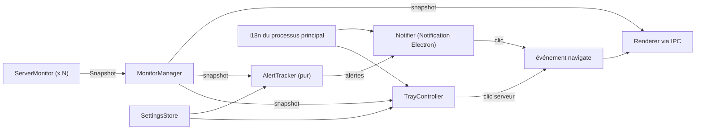

# lookout : vue multi-serveurs, barre de menus et notifications (plan)

Date : 2026-11-11. Statut : **validé**. Base : `main` @ `107f198` (v0.1.1).

## 1. Intention

La spec V0 promet qu'en ouvrant l'app le matin on comprend **en quelques secondes** que tout va bien. Aujourd'hui, on ne voit qu'un serveur à la fois. Les autres se résument à un point de couleur dans la barre latérale, et il faut garder la fenêtre ouverte pour savoir si quelque chose casse.

Ce chantier apporte trois choses :

1. **Vue « Tous les serveurs »** : un écran qui résume les 2 à 5 VPS d'un coup, avec les problèmes en premier.
2. **Icône dans la barre de menus (Mac) ou dans la zone de notification (Windows)** : sa couleur montre le pire état de tous les serveurs, et un menu liste les serveurs.
3. **Notifications système** quand un projet ou un serveur passe au rouge, même fenêtre fermée.

### Garde-fous (règles du projet)
- **Aucune nouvelle commande sur le serveur** et aucune action qui modifie la production : on réutilise les instantanés existants.
- **Aucun trafic réseau nouveau** : notifications et icône sont 100 % locales.
- **Tous les textes passent par l'i18n**, en anglais et en français, y compris ceux du processus principal (menu, notifications).
- **TDD** à chaque tâche, un commit Conventional Commits par tâche.

### Hors périmètre
Historique des métriques conservé sur disque, seuils réglables, alertes d'expiration des certificats (petite tâche séparée, à faire ensuite : elle s'appuiera sur `issues.ts` créé ici), sections Conteneurs, Bases et Déploiements.

## 2. Vue d'ensemble technique

### Rythme de collecte : trois « focus » au lieu d'un serveur actif
Aujourd'hui, le serveur affiché est interrogé toutes les 5 s et les autres toutes les 45 s. On remplace `setActiveServer(id)` par un **focus** :

| Focus | Quand | Serveur affiché | Autres serveurs |
|---|---|---|---|
| `server` | Écran d'un serveur visible | 5 s | 45 s |
| `fleet` | Vue « Tous les serveurs » visible | 15 s pour tous | 15 s pour tous |
| `none` | Fenêtre fermée, cachée ou réduite | 45 s pour tous | 45 s pour tous |

Cela allège aussi la charge quand la fenêtre est fermée : aujourd'hui, le serveur actif continue d'être interrogé toutes les 5 s.

### Une seule définition du « pourquoi »
La raison pour laquelle un projet n'est pas vert (« CPU 71 % », « arrêté »…) est aujourd'hui calculée dans `src/renderer/components/ConsumptionList.tsx` (`cause()`). Elle passe dans `src/shared/issues.ts`, en données structurées. Elle sert ensuite à la liste existante, aux cartes de la vue d'ensemble et au texte des notifications.

### Anti-spam des notifications (`AlertTracker`, pur, horloge injectée)
- **Référence silencieuse** : le premier instantané d'un serveur fixe son état sans notifier. L'icône, elle, est déjà rouge.
- **Persistance** : un état doit se confirmer sur **2 instantanés consécutifs** avant de déclencher une notification, pour éviter les pics de CPU passagers.
- **Délai minimum** : au plus une notification par élément (serveur ou projet) toutes les **30 min**, sauf aggravation (orange → rouge).
- **Regroupement** : plusieurs problèmes sur un même serveur dans le même instantané donnent **une seule** notification (« 3 problèmes sur vps-paris »).
- **Retour à la normale** : notification « de nouveau OK », désactivable.
- **Par défaut** : seul le **rouge** notifie. L'orange est une option.
- **Serveur injoignable** : rouge. Si la connexion est refusée (authentification, empreinte de l'hôte), une seule notification : « action requise ».

## 3. Tâches

Chaque tâche suit le même cycle : tests qui échouent → vérifier l'échec → implémenter → `npm run lint && npm run typecheck && npm test` → commit.

### Tâche 1 : réglages généraux (`SettingsStore`)
- **Problème actuel** : `setLanguage` réécrit tout `settings.json` avec `{ language }`. Tout nouveau réglage serait effacé.
- `src/shared/types.ts` : `Preferences = { language: 'en' | 'fr'; notifications: { enabled: boolean; warnings: boolean; recoveries: boolean }; keepInTray: boolean }` et `DEFAULT_PREFERENCES`.
- `src/main/store/settings.ts` : `get(): Preferences` (fusionne avec les valeurs par défaut, tolère un fichier absent ou corrompu) et `update(patch)` (fusion, écriture atomique comme `serverStore`). `getLanguage` et `setLanguage` restent comme raccourcis. Un `onChange(cb)` prévient les autres services.
- IPC : `settings.get()` et `settings.update(patch)` dans `LookoutApi`, le handler (validation stricte de chaque champ : un type inattendu ou une clé inconnue est refusé) et le preload.
- Tests : fusion, valeurs par défaut, fichier corrompu, `setLanguage` qui ne perd pas les autres réglages, entrées IPC hostiles (`{ notifications: 'yes' }`, `__proto__`, tableau…).
- Commit : `feat: general preferences with safe merge`

### Tâche 2 : « pourquoi » et résumé de flotte (`src/shared`, pur)
- `issues.ts` : `projectIssues(project, containers, host, thresholds)` renvoie une liste triée par gravité de `{ kind: 'cpu' | 'mem' | 'stopped' | 'restarting' | 'unhealthy' | 'paused', status, value?, container? }`. `serverIssues(snapshot)` renvoie `unreachable`, `auth`, `hostkey`, pression CPU/RAM/disque de l'hôte, `docker_unavailable`.
- `fleet.ts` : `fleetSummary(servers, snapshots, now)` renvoie, par serveur, l'état, les % CPU/RAM/disque, le nombre de projets par état, les 3 problèmes principaux et l'âge des données. Les serveurs sont triés rouge → orange → vert → neutre, puis par nom. `fleetStatus()` donne le pire état.
- `ConsumptionList` utilise `projectIssues` au lieu de `cause()` (son comportement ne change pas, et ses tests existants le garantissent).
- Tests : chaque type de problème à partir de conteneurs fabriqués, ordre de tri, serveur sans instantané (neutre, « en attente »), RAM de l'hôte à 0.
- Commit : `refactor: share project issue reasons` puis `feat: fleet summary`

### Tâche 3 : focus de collecte et dernier instantané
- `ServerMonitor` : `intervals` reçoit en plus `fleetMs` (15 000). `setMode('foreground' | 'fleet' | 'background')` remplace `setActive(boolean)`. Un passage à un mode plus rapide déclenche une collecte immédiate. `latest(): Snapshot | null`.
- `MonitorManager` : `setFocus({ kind: 'server', id } | { kind: 'fleet' } | { kind: 'none' })` et `latest(): Snapshot[]`. Le focus choisi avant l'ajout d'un moniteur s'applique toujours (comportement actuel conservé).
- IPC : `monitor.setFocus(focus)` (remplace `setActive`, validé) et `monitor.latest()`. Au retour de la fenêtre, l'interface affiche ainsi tout de suite l'état connu au lieu d'attendre jusqu'à 45 s.
- Tests (faux minuteurs) : délais de chaque mode, collecte immédiate au passage en `fleet`, `none` qui ralentit tout, retour exponentiel après échec conservé, IPC hostile.
- Commit : `feat: fleet and background polling focus`

### Tâche 4 : i18n dans le processus principal
- `src/main/i18n.ts` : une instance `i18next` séparée qui charge **les mêmes** `en.json` et `fr.json`, et suit `preferences.language` via `onChange`.
- Nouvelles clés `tray.*` et `notify.*` dans les deux fichiers. Le test de parité existant couvre le français.
- Tests : la traduction suit le changement de langue, et les pluriels (« 1 problème » / « 3 problèmes ») en anglais et en français.
- Commit : `feat: translations in the main process`

### Tâche 5 : `AlertTracker` (pur)
- `src/main/alerts/alerts.ts` : `new AlertTracker({ now, minIntervalMs: 1_800_000, confirmations: 2 })`. `observe(snapshot, prefs)` renvoie `Alert[]` (`{ serverId, projectId?, level: 'error' | 'warn' | 'recovered' | 'action', issues }`), regroupées par serveur. `forget(serverId)` sert quand un serveur est retiré.
- Tests : la référence silencieuse, la confirmation sur 2 instantanés, un pic isolé ignoré, le délai de 30 min, l'aggravation qui passe outre le délai, le regroupement, les retours à la normale (activés ou non), l'orange (activé ou non), une authentification refusée signalée une seule fois, un serveur retiré oublié.
- Commit : `feat: alert tracker with debounce and cooldown`

### Tâche 6 : notifications et navigation
- `src/main/notify/notifier.ts` : il reçoit `show(title, body, onClick)` par injection. En production, c'est `new Notification(...)` d'Electron, sans son pour l'orange. Il formate les alertes avec l'i18n du processus principal et `issues`.
- Windows : `app.setAppUserModelId(APP_ID)` au démarrage, sans quoi Windows n'affiche aucune notification. `APP_ID` vient de `brand.ts`.
- Nouvel événement `EVENT_CHANNELS.navigate` (`{ serverId, projectId? }`) et `LookoutApi.app.onNavigate(cb)`. Un clic sur une notification ouvre ou rétablit la fenêtre et va au serveur ou au projet concerné.
- `runtime.ts` branche `manager.onSnapshot` → `tracker.observe` → `notifier`, et respecte `notifications.enabled`.
- Tests : le texte en anglais et en français, le clic qui appelle `focusWindow` et émet `navigate`, rien de montré quand les notifications sont désactivées.
- Commit : `feat: desktop notifications when a project turns red`

### Tâche 7 : icône dans la barre de menus ou la zone de notification
- `src/main/tray/icon.ts` (pur) : `dotBitmap(status, size)` dessine un disque coloré en RGBA, en 16 px et 32 px (@2x), avec les couleurs du thème Tailwind. Aucun fichier image à embarquer.
- `src/main/tray/menu.ts` (pur) : `trayMenuTemplate(summary, t)` produit la liste des serveurs (point de couleur et premier problème), puis « Ouvrir lookout », « Tous les serveurs » et « Quitter ». Les actions sont des identifiants, sans fonctions, pour rester testable.
- `src/main/tray/controller.ts` : une enveloppe fine autour de `Tray` et `Menu`, reçus par injection, qui se met à jour à chaque instantané (seulement si le résumé change) et à chaque changement de langue.
- Cycle de vie de la fenêtre (`index.ts`) :
  - Mac : la fermeture garde l'app active, comme aujourd'hui. L'icône rouvre la fenêtre.
  - Windows : si `keepInTray` est activé (par défaut), fermer la fenêtre la cache au lieu de quitter. « Quitter » dans le menu arrête vraiment l'app. Un message unique explique, au premier masquage, que l'app continue dans la zone de notification.
  - Fenêtre cachée, réduite ou fermée → focus `none`. Fenêtre de nouveau visible → l'interface renvoie son focus.
- Tests : les pixels du disque (centre coloré, coins transparents), le menu (ordre, libellés traduits, aucun serveur, serveur injoignable), un instantané sans changement qui ne reconstruit pas le menu.
- Commit : `feat: status icon in the menu bar and system tray`

### Tâche 8 : état de l'interface (Zustand)
- `store.ts` : `focus` remplace l'usage direct de `activeId` pour la collecte. `init()` charge `monitor.latest()` puis écoute les instantanés et `onNavigate`. `preferences` est chargé et mis à jour.
- `App.tsx` : la vue `{ name: 'fleet' }` est l'écran de départ **dès qu'il y a 2 serveurs ou plus**, sinon on garde l'écran du serveur comme aujourd'hui. `onNavigate` ouvre le bon serveur ou projet.
- Tests : le focus envoyé quand on change de vue, la navigation reçue du processus principal, l'état initial pris dans `latest()`.
- Commit : `feat: renderer focus and navigation from notifications`

### Tâche 9 : écran « Tous les serveurs »
- `src/renderer/screens/Fleet.tsx` affiche une grille de cartes, une par serveur, triées par gravité :
  - Nom, point d'état, âge des données (« il y a 12 s »).
  - Trois barres simples CPU / RAM / Disque, dans le style des cartes existantes, sans courbes chargées.
  - Compteur de projets par état (● 4 ● 1 ● 0).
  - Jusqu'à 3 problèmes cliquables (→ page du projet), puis « +N autres ».
  - Serveur injoignable : la cause en clair et un bouton « Réessayer » (`monitor.retry`).
- Clic sur la carte → écran du serveur. Barre latérale : une entrée « Tous les serveurs », avec le pire état, au-dessus de la liste.
- Si tout est vert, une seule ligne en haut : « Tout va bien sur N serveurs ».
- Tests (jsdom) : l'ordre des cartes, les clics (carte, problème, réessayer), le message « tout va bien », un serveur en attente du premier instantané, les textes en français.
- Commit : `feat: all servers overview`

### Tâche 10 : écran Réglages
- `src/renderer/screens/Settings.tsx`, accessible depuis le bas de la barre latérale. On y trouve : la langue (le sélecteur actuel y est déplacé), les notifications (activées, avertissements orange, retours à la normale), « Garder lookout dans la zone de notification à la fermeture » (affiché sur Windows seulement), et un bouton « Tester une notification ».
- Tests : chaque interrupteur appelle `settings.update` avec le bon patch, et l'option Windows est masquée sur Mac.
- Commit : `feat: settings screen`

### Tâche 11 : démo, smoke test, documentation
- `dev:demo` ajoute un **second serveur volontairement injoignable** (port fermé), pour montrer la vue d'ensemble avec un rouge.
- `scripts/smoke.mjs` : l'écran de départ est la vue « Tous les serveurs » → carte du VPS de démo → l'écran du serveur, puis le parcours existant.
- README (ce que fait l'app), CONTRIBUTING (la liste des limites connues) et AGENTS.md (`alerts/`, `tray/`, `notify/` dans l'arborescence).
- Vérification à la main, sur Mac et sur Windows : notification réelle, icône, fermeture vers la zone de notification.
- Commit : `test: smoke covers the overview` puis `docs: overview, tray and notifications`

## 4. Risques et points d'attention
- **Mac, app non signée** : les notifications d'une app signée ad hoc fonctionnent, mais macOS demande l'autorisation au premier envoi. On le documente dans le README.
- **Windows** : sans `setAppUserModelId`, aucune notification ne s'affiche. On le teste, et on le vérifie à la main sur une machine Windows.
- **Charge SSH en vue d'ensemble** : 5 serveurs interrogés toutes les 15 s. Les données lentes (Git, domaines, disque Docker) restent en cache comme aujourd'hui, donc une collecte courante reste légère.
- **Délai d'alerte fenêtre fermée** : jusqu'à environ 90 s (45 s × 2 confirmations). C'est acceptable pour un outil de confort ; ce n'est pas un outil d'astreinte.

## 5. Décisions à valider
1. **Vue d'ensemble interrogée toutes les 15 s** (la spec prévoyait 30 à 60 s pour les serveurs non affichés) ?
2. **Notifications : rouge seulement par défaut**, l'orange en option, et « de nouveau OK » activé par défaut ?
3. **Windows : fermer la fenêtre garde l'app dans la zone de notification** par défaut ?
4. **Vue « Tous les serveurs » comme écran de départ** dès 2 serveurs ?
5. Une fois validé, j'enregistre ce plan dans `docs/superpowers/plans/2026-11-11-lookout-flotte-notifications.md`, pour suivre la convention du dépôt.
