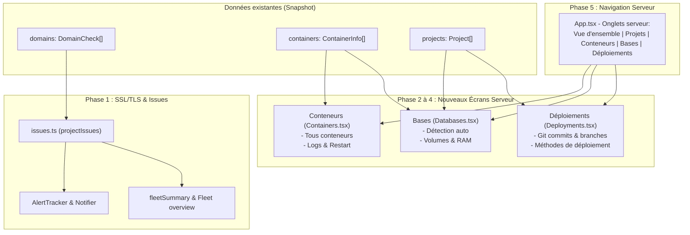

# lookout : sections Conteneurs, Bases, Déploiements et surveillance SSL/TLS (plan)

Date : 2026-11-11 · Statut : **terminé** · Base : `main` @ `5e12745` (v0.1.1).

---

## 1. Contexte & Intention

Avec la mise en place de la vue multi-serveurs, de la barre de menus et des notifications système, la supervision globale de la flotte est en place.
Pour atteindre l'objectif promis dans la spec de conception V0 — **remplacer complètement le terminal pour les gestes et vérifications courantes** —, il reste à compléter la vision détaillée au niveau d'un serveur et à fermer le trou de détection sur les certificats Web.

Ce chantier apporte deux volets complémentaires :

1. **Surveillance des certificats SSL/TLS** :
   - Prise en compte immédiate des certificats expirés (`error`) et expirant sous 14 jours (`warn`).
   - Intégration dans le calcul de santé des projets (`project.status`), les résumés de flotte (`fleetSummary`) et les notifications bureau (`AlertTracker`).
2. **Sections serveur de la spec V0 (`Conteneurs`, `Bases`, `Déploiements`)** :
   - Aujourd'hui, l'écran d'un serveur ne propose que deux onglets : « Vue d'ensemble » et « Projets ».
   - On ajoute les 3 onglets manquants définis dans la spec (§7.3) :
     - **Conteneurs** : liste complète de tous les conteneurs Docker (y compris ceux hors Compose), avec statut de santé, CPU/RAM, accès direct aux logs et redémarrage sécurisé avec confirmation.
     - **Bases** : détection automatique des conteneurs de bases de données (PostgreSQL, MySQL, Redis, MongoDB, ClickHouse, etc.), taille des volumes, statut et ressources.
     - **Déploiements** : tableau de bord de l'état Git et des méthodes de déploiement de tous les projets du serveur (branche, dernier commit, date).

---

## 2. Garde-fous et règles strictes

- **Aucune nouvelle commande distante superflue** : les conteneurs, les métriques et les domaines sont déjà présents dans le `Snapshot` collecté.
- **Zéro trafic réseau non sollicité** : les vérifications TLS restent strictement locales lors des sondages périodiques existants.
- **TDD systématique** : test qui échoue d'abord, implémentation, passage de l'ensemble de la suite CI (`lint`, `typecheck`, `test`).
- **Confirmation obligatoire** : toute action de redémarrage depuis l'onglet Conteneurs passe par le flux sécurisé `ActionService` / `ConfirmDialog` affichant la commande exacte.
- **Parité i18n stricte** entre `en.json` et `fr.json`.

---

## 3. Architecture & Découpage technique



---

## 4. Tâches détaillées

### Tâche 1 : Détection et alertes sur les certificats SSL/TLS
- **Calcul de santé** :
  - Dans `src/main/detect/projects.ts` : si un domaine rattaché à un projet a un certificat expiré (`tls.ok === false` ou `daysLeft < 0`), le statut du projet passe en `error`. Si `daysLeft <= 14`, le statut passe en `warn` (si pas déjà `error`).
  - Idem pour les sites statiques.
- **Données d'anomalies** (`src/shared/issues.ts`) :
  - Ajout des types `cert-expired` (`status: 'error'`, nom de domaine, erreur) et `cert-expiring` (`status: 'warn'`, nom de domaine, jours restants).
- **Traductions et notifications** :
  - Clés i18n dans `en.json` et `fr.json` (`notify.certExpired`, `notify.certExpiring`, `issues.certExpired`, etc.).
  - Formatage clair dans les cartes de flotte et les notifications bureau (« Domaine example.com : certificat expiré »).
- **Tests** :
  - `projects.test.ts` : projet avec domaine expiré $\to$ `error`, $\le 14$ jours $\to$ `warn`, domaine sain $\to$ `ok`.
  - `issues.test.ts` : génération des `ProjectIssue` correspondantes.
  - `notifier.test.ts` : texte de la notification en anglais et en français.
- **Commit** : `feat: ssl certificate expiration alerts and project health`

---

### Tâche 2 : Écran « Conteneurs » (`Containers.tsx`)
- **Composant** `src/renderer/screens/Containers.tsx` :
  - Liste/tableau épuré de tous les conteneurs (`snapshot.containers`).
  - Colonnes : Nom, Statut (avec `StatusDot`), Santé (`healthy`, `unhealthy`, `starting`), Projet rattaché (ou badge « Indépendant »), Image Docker, Ports exposés, Consommation CPU & RAM instantanée.
  - Champ de recherche / filtre rapide pour trouver un conteneur parmi des dizaines.
  - Bouton **Logs** pour ouvrir le visualiseur de logs plein écran.
  - Bouton **Redémarrer** branché sur `useRestart` (affiche la boîte de dialogue de confirmation avec commande exacte).
- **Tests** :
  - `src/renderer/screens/Containers.test.tsx` : affichage, filtrage, clic sur logs, clic sur redémarrage.
- **Commit** : `feat: server containers screen with logs and restart`

---

### Tâche 3 : Détection et écran « Bases de données » (`Databases.tsx`)
- **Module partagé de détection** `src/shared/databases.ts` (pur) :
  - Liste de signatures d'images courantes :
    - PostgreSQL (`postgres`), MySQL (`mysql`), MariaDB (`mariadb`), Redis (`redis`, `valkey`), MongoDB (`mongo`), SQLite / volumes de bases, ClickHouse (`clickhouse`), Elasticsearch (`elasticsearch`), RabbitMQ (`rabbitmq`).
  - Fonction `detectDatabases(containers, diskByProject)` extrayant pour chaque base :
    - Type de base, nom du conteneur, port standard/exposé, taille estimée du volume, CPU et RAM consommés, statut de santé.
- **Composant** `src/renderer/screens/Databases.tsx` :
  - Grille de cartes pour les bases de données détectées.
  - Si aucune base n'est détectée : message sobre invitant à vérifier les conteneurs.
  - Statut en direct, mémoire occupée, volume disque.
- **Tests** :
  - `databases.test.ts` : détection des différentes technologies et extraction de leurs métriques.
  - `Databases.test.tsx` : rendu de la grille et des détails.
- **Commit** : `feat: databases discovery and screen`

---

### Tâche 4 : Écran « Déploiements » (`Deployments.tsx`)
- **Composant** `src/renderer/screens/Deployments.tsx` :
  - Vue consolidée de tous les projets du serveur et de leurs informations Git.
  - Tableau / cartes :
    - Nom du projet et badge de type (`compose`, `container`, `static`).
    - Méthode de déploiement estimée : `ci-image` (déploiement via image pré-construite), `git-pull` (dépôt cloné sur le serveur), `file-copy` (fichiers copiés).
    - Dépôt distant (`origin`), branche active (`branch`).
    - Dernier commit : hash court cliquable / copiable, message de commit, auteur, date relative.
    - Clic sur la ligne ouvrant la page dédiée du projet.
- **Tests** :
  - `src/renderer/screens/Deployments.test.tsx` : affichage des projets avec git, gestion des projets sans git ou avec image seule.
- **Commit** : `feat: deployments summary screen`

---

### Tâche 5 : Navigation dans `App.tsx` & Finalisation
- **Navigation dans `App.tsx`** :
  - Étendre `View` :
    ```ts
    type View =
      | { name: 'fleet' }
      | { name: 'overview' }
      | { name: 'projects' }
      | { name: 'containers' }
      | { name: 'databases' }
      | { name: 'deployments' }
      | { name: 'project'; id: string }
      | { name: 'add' }
      | { name: 'settings' }
    ```
  - Barre d'onglets du serveur enrichie :
    `Vue d'ensemble` | `Projets` | `Conteneurs` | `Bases` | `Déploiements`.
- **Traductions** :
  - `nav.containers`, `nav.databases`, `nav.deployments` dans `en.json` et `fr.json`.
- **Documentation & Validation** :
  - Mettre à jour `README.md` et `AGENTS.md`.
  - Exécuter la chaîne CI complète : `npm run lint && npm run typecheck && npm test && npm run build && npm run smoke`.
- **Commit** : `feat: server navigation with containers, databases and deployments tabs`

